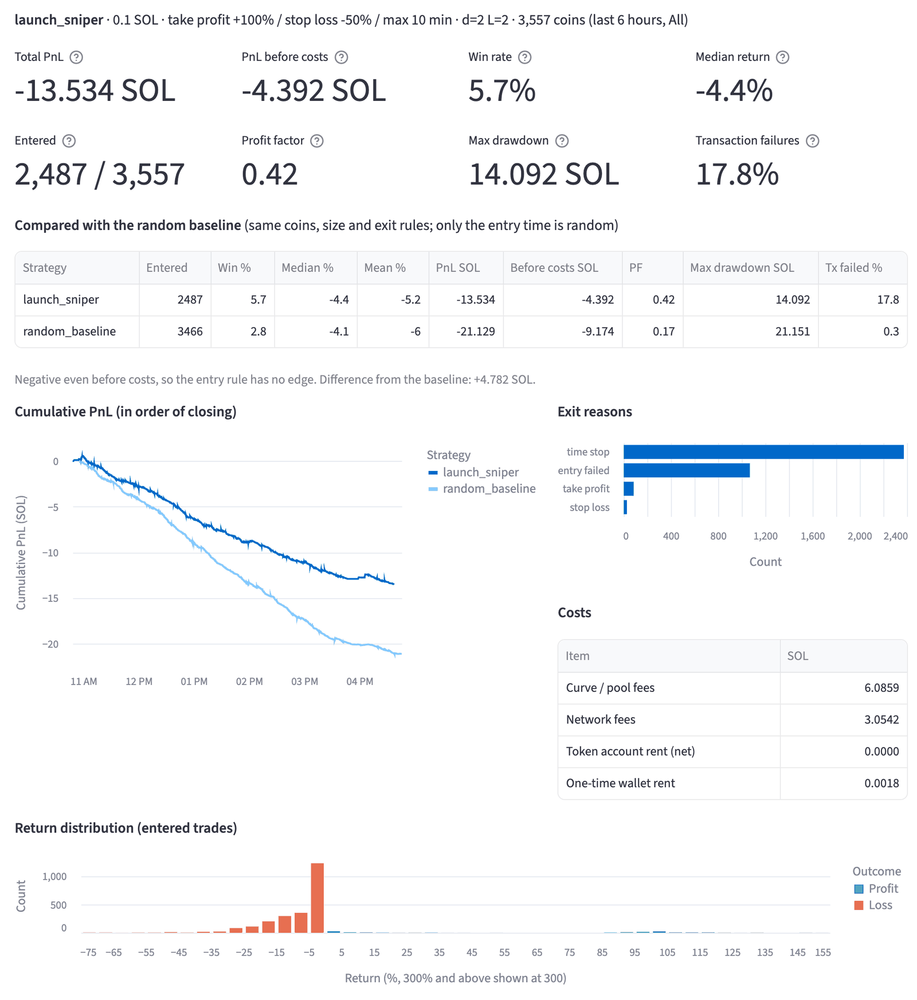
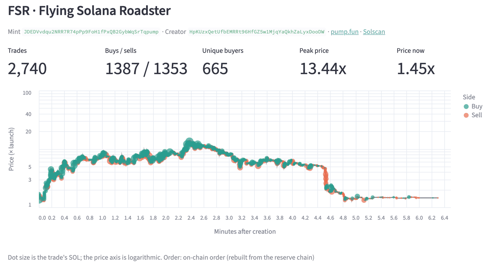
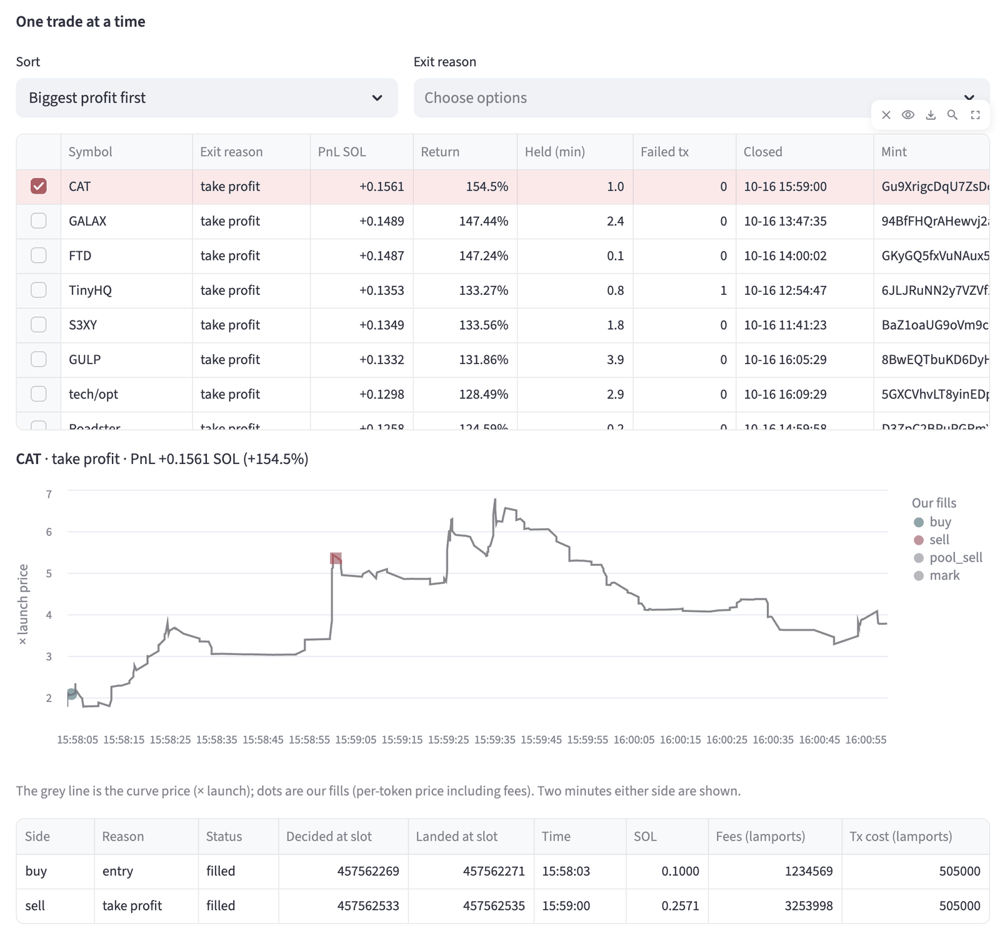

# pumpfun-sim

[](https://github.com/windowopner/pumpfun-sim/actions/workflows/tests.yml)

Paper-trading research on [Pump.fun](https://pump.fun), the Solana memecoin launchpad: a live on-chain event collector, a bonding-curve model that reproduces every recorded trade to the lamport, a backtest engine with realistic latency and costs, and a dashboard to look at all of it.

> **Unofficial and for learning only.** Not affiliated with Pump.fun. Nothing here places real trades or touches a wallet or private key: it only reads public on-chain data and simulates. Not financial advice. The strategies included lose money, and that is one of the findings.



## What it does

| Part | What it is |
| --- | --- |
| **Collector** | Subscribes to the Pump program's logs over a Solana RPC websocket, decodes `CreateEvent` / `TradeEvent` / graduation events with the official IDL, and stores them in SQLite. Tracks exactly which slots it covered, so gaps are known. |
| **Market model** | Bonding-curve math in integer lamports that matches what the on-chain program records, not what the official SDK quotes. Verified against **2,309,807 of 2,309,807** recorded mainnet trades. |
| **Replay** | Restores on-chain order inside a slot (the RPC stream does not keep it) by chaining each trade's reserves, and replays events at the moment a strategy could have seen them. |
| **Engine** | Fills a strategy's orders on the true curve state at the landing slot: observation delay, landing latency, slippage failures, network and priority fees, token-account rent, and a forced exit into the PumpSwap pool on graduation. |
| **Dashboard** | Streamlit app: collector health and gaps, coin explorer with price history, simulation runner with baseline comparison and per-trade charts, and a live map of the code. English, with a Korean option. |

## Dashboard

Every coin's life, trade by trade, in on-chain order (here, a coin that ran to 13× and collapsed within five minutes):



And every simulated trade, with the fills drawn on the real curve and their fees and costs to the lamport:



## Quick start

Python 3.9 or newer.

```bash
git clone https://github.com/windowopner/pumpfun-sim.git
cd pumpfun-sim
python3 -m venv .venv && source .venv/bin/activate
pip install --upgrade pip && pip install -e .

pumpfun demo          # dashboard on the bundled half-hour sample, no setup needed
```

With your own data:

```bash
pumpfun collect                                   # record live events into data/pump.db (Ctrl-C to stop)
pumpfun sim --strategy launch_sniper --baseline   # backtest, compared with a random-entry baseline
pumpfun dashboard                                 # the dashboard on data/pump.db
pumpfun dashboard --lang ko                       # 한국어 UI (or pick it in the sidebar)
pumpfun --help
```

The collector uses the public mainnet RPC by default. It works, but it is rate limited and drops the connection now and then; set `SOLANA_WS_URL` to your own RPC websocket for anything long-running. Data goes to `./data`, or `$PUMPFUN_DATA`.

## How it works

```
Solana RPC ──logsSubscribe──► collector ──► SQLite ──► replay ──► engine ◄──► strategy
                                 │                       ▲          │
                         official IDL decoder       market model    └──► report / dashboard
```

A few things that turned out to matter:

- **The program, not the SDK, is the reference.** For SOL-in buys the program computes fees on an initial estimate and takes any overshoot out of the curve amount; the SDK's quote formula got the token count right in only 5 of 18 real transactions. A buy completes the curve only when the tokens it would get reach what is left, not when its SOL covers the cost of the rest (a buy whose SOL exactly covered the rest still left dust). Legacy cashback coins pay their creator fee as cashback inside the same fee denominator. All of this was found by replaying real trades until every one matched.
- **Order inside a slot can be recovered.** Every `TradeEvent` carries the reserves right after the trade, so the reserves right before it follow, and the next trade is the one that starts from the current state. This orders 100% of normal coins without fetching blocks.
- **The stream has noise.** The public RPC sometimes sends notifications with an all-ones signature for trades that never landed, and stalls without disconnecting. The collector filters the first and records covered slot ranges so the simulator never trusts a gap.
- **No lookahead.** A strategy sees an event at `slot + d`, its order lands at `+ L`, and it learns the result `d` slots after that. The create transaction is seen whole (the creator's own buy included).

Full design, rules and measurements: [docs/sim-design.md](docs/sim-design.md). Protocol notes (in Korean): [docs/protocol-notes.md](docs/protocol-notes.md).

## What the data says

About 22 hours of mainnet data, 20,809 coins, 0.1 SOL per entry, exit at +100% / −50% / 10 minutes:

| Strategy | Entered | Win rate | Median return | PnL (SOL) | PnL before costs | Profit factor |
| --- | --- | --- | --- | --- | --- | --- |
| `launch_sniper` (buy on creation) | 14,568 | 4.1% | −4.5% | −97.31 | −44.01 | 0.30 |
| `random_baseline` (random entry time) | 20,400 | 2.6% | −4.1% | −114.91 | −44.43 | 0.18 |

- Both lose money even before fees: the median coin goes down over ten minutes. Before costs, buying at launch is no better than buying at a random time.
- 30% of launch entries fail: bots buying in the same block as the coin's creation move the price past 15% slippage before a follow-up order lands.
- Of coins that graduate, most do it in the same slot they are created (the creator buys the whole curve), so they cannot be entered at all.
- Latency (1+1 to 3+5 slots) changes the result little; size changes it a lot. Ten times the size loses about twenty times as much before costs, because a bigger order moves the curve against itself.

## Writing a strategy

```python
from pumpfun.sim.engine import Buy, Sell, Strategy

class BuyWhenPopular(Strategy):
    def on_trade(self, coin, trade, pos, ctx):
        if pos is None and coin.unique_buyers >= 20 and not coin.creator_sold and coin.slots_since_create < 150:
            return [Buy(100_000_000)]                    # 0.1 SOL, 15% slippage
        if pos and pos.tokens and pos.exit_value(coin.state) > 1.5 * pos.quote_in:
            return [Sell(1.0, reason="take profit")]
        return []
```

Hooks: `on_create`, `on_trade`, `on_complete`, `on_tick` (called while you hold, and at times you ask for with `ctx.wake`), `on_fill`. Register it in `pumpfun/sim/strategies/__init__.py` to run it with `pumpfun sim --strategy <name>`. Use `--period tune` to shape the rules and `--period test` to judge them.

## Project layout

```
pumpfun/
  cli.py                 the `pumpfun` command
  collect/               collector, log filter, IDL decoder, SQLite store, idl/pump.json
  sim/                   market model, replay, engine, report, runner, strategies/
  dashboard/             Streamlit app (i18n.py + ko.py: English UI with Korean)
  sample.py              build / unpack the bundled sample
  samples/               half an hour of real data (7.6 MB gzip)
tests/                   50 tests, real mainnet transactions as fixtures
docs/                    design notes and protocol notes
```

## Tests

```bash
python3 -m unittest discover tests                      # ~3 s, on the bundled sample
PUMP_DB=data/pump.db python3 -m unittest discover tests  # replay everything you collected
```

## Limitations

- Our own trades move the curve for our fills, but everyone else's recorded trades are replayed unchanged. Entry size is capped at 2% of the curve's reserves to keep that error small.
- After graduation, positions are sold at the PumpSwap pool's opening reserves with a haircut; PumpSwap trades are not collected yet.
- Mayhem-mode coins and coins paired with anything other than SOL are excluded.
- Pump.fun changes its programs every few weeks. When `decode_err` appears in the collector's output or the replay tests fail, update `pumpfun/collect/idl/pump.json` from [pump-public-docs](https://github.com/pump-fun/pump-public-docs).

## License

[MIT](LICENSE)
